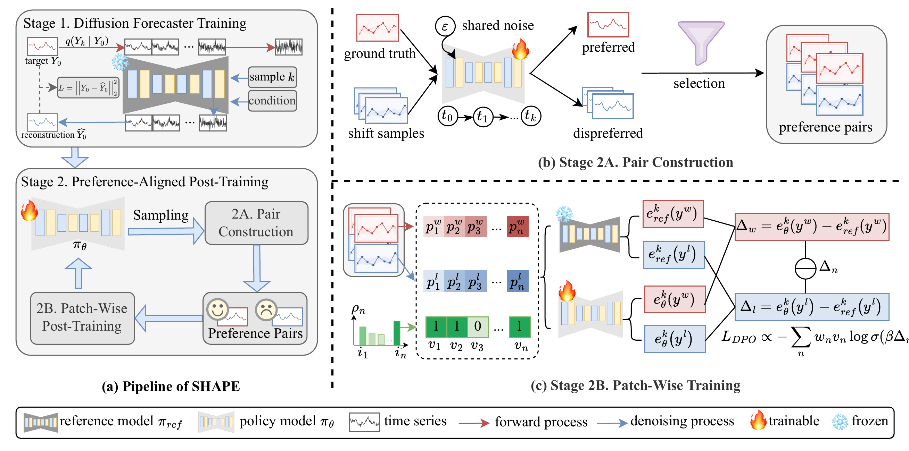

# SHAPE: Shift-Aware Preference Alignment for Probabilistic Time Series Forecasting

The repo is the official implementation for the paper **SHAPE: Shift-Aware Preference Alignment for Probabilistic Time Series Forecasting** (submitted to arXiv; public link pending).

## Overall Framework



At Stage 1, we train a base conditional diffusion forecaster and freeze it as the reference model $\pi_{\mathrm{ref}}$. At Stage 2, the policy $\pi_\theta$ is initialized from $\pi_{\mathrm{ref}}$ and optimized with shift-aware preferences, while the reference model remains fixed to constrain policy drift.

SHAPE can be applied to conditional diffusion models with a denoising objective and a sampling process. This release provides a D³U-based ETTm1 example; other architectures require adapting the model interfaces.

## Installation

Use Python 3.11 and a CUDA-enabled PyTorch installation compatible with your GPU:

```bash
pip install -r requirements.txt
```

## Data and Checkpoints

Download `ETTm1.csv` from the [ETT dataset repository](https://github.com/zhouhaoyi/ETDataset) and place it at:

```text
dataset/ETT-small/ETTm1.csv
```

The ETTm1 example loads the supplied point forecasting and Stage 1 diffusion checkpoints from `pretrain_checkpoints/` and `checkpoints/`, respectively.

## Usage

Run all commands from the repository root. The example uses 96 historical steps to forecast the next 192 steps.

### Training and Evaluation

Run Stage 2 alignment and test the trained model:

```bash
GPU=0 SEEDS="2021" RUN_TAG_BASE=shape bash scripts/ettm1_s2.sh
```

### Evaluation Only

Evaluate a trained Stage 2 checkpoint using the same seed and run tag:

```bash
GPU=0 SEEDS="2021" RUN_TAG_BASE=shape RUN_MODE=test bash scripts/ettm1_s2.sh
```

## Contact

If you have any questions about this work or the code, please contact [Xiaoyang Li](mailto:xiaoyang.li01@adelaide.edu.au).

## Acknowledgement

This repository is built on [D³U](https://github.com/Torea-L/D3U). We thank the authors for their valuable code and efforts.
